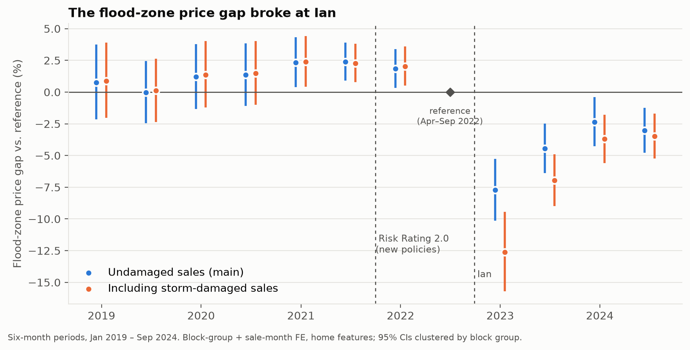
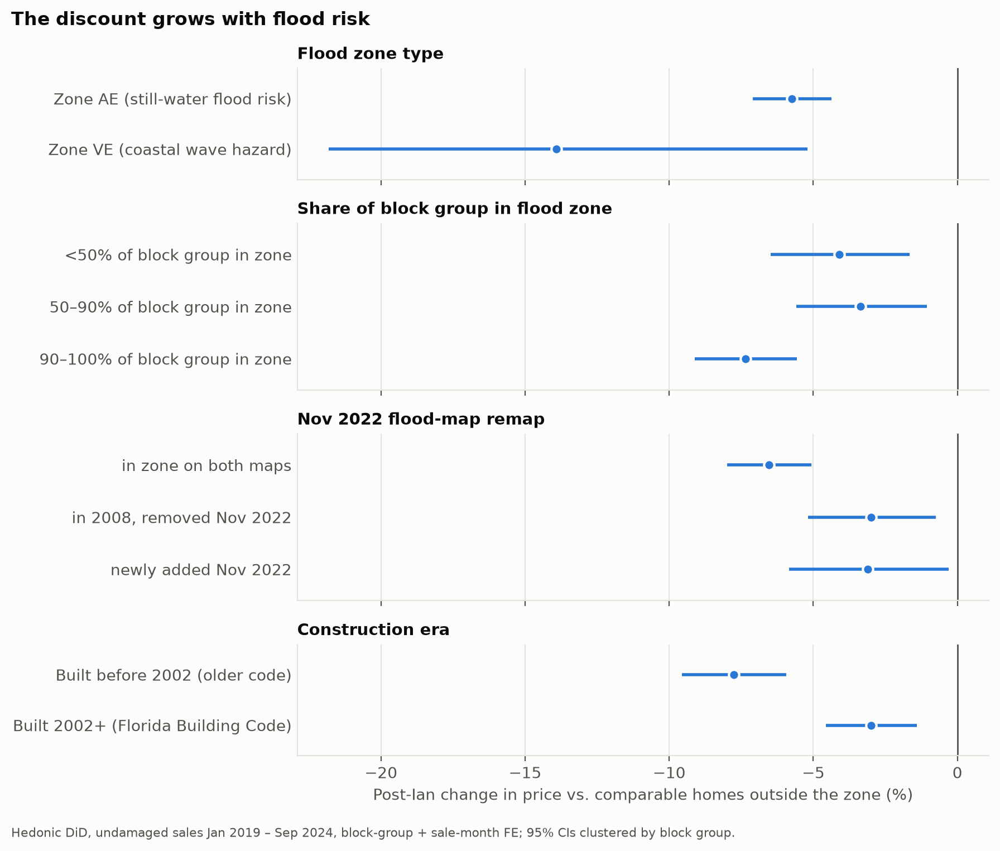

# Lee County Home Prices: What Drives Value, and What Did Hurricane Ian Change?

An end-to-end analysis of **~147,000 qualified home and condo sales** (2019–2025) in Lee County, Florida
(Fort Myers, Cape Coral, Sanibel), built entirely from public records: property-appraiser sales and tax rolls,
county GIS parcels, FEMA flood maps, and FRED mortgage rates.

It asks three questions:

1. **Prediction:** how accurately can public data price a home? *(an automated valuation model, like a Zestimate)*
2. **Causal impact:** did **Hurricane Ian** (Sept 2022, Category 4) lower values of homes in FEMA's high-risk
   flood zone, relative to comparable homes outside it?
3. **Policy:** did Florida's post-Surfside **condo safety law** (SB 4-D, 2022) lower prices of the taller
   buildings it covers?

## Key findings

| | Result |
|---|---|
| **Ian's flood-zone discount** | Flood-zone homes sold for **~6% less** than comparable homes after Ian (−5.8%, 95% CI −7.2 to −4.5); robust range −2% to −8%; repeat sales −4.4%; placebo test null |
| **It scales with risk** | **−14%** in coastal wave-hazard (VE) zones, −7% deep in the flood zone, −3 to −4% near its edge |
| **Newer construction held value** | Pre-2002 homes **−7.8%** vs. **−3.0%** for homes built under the post-Andrew Florida Building Code |
| **Scale** | Roughly **$3–4 billion** of single-family housing value across ~88,000 flood-zone homes |
| **Price model** | Forecasting 2025 sales from 2019–2024 data: **9.1% median error, 54% within ±10%**, beating the county appraiser's (adjusted) values (10.4%) |
| **Condo law** | Older 3+ story condos fell **~6% behind** low-rise condos in the 2024 deadline year. But tall condos were already declining relative to low-rise ones before the law, so the effect is **not distinguishable from that trend**. Reported as inconclusive. |



*The flood-zone price gap (comparable homes, same block group, same month) broke at Ian: about −8% in the first
six months, settling at −2.5% to −4.5%.*



## What's in the project

| Notebook | What it does |
|---|---|
| [`00_data_exploration`](notebooks/00_data_exploration.ipynb) | Opens every raw source: join keys, qualification codes, flood maps |
| [`01_build_dataset`](notebooks/01_build_dataset.ipynb) | Cleaning decisions and the analysis-ready datasets |
| [`02_eda_single_family`](notebooks/02_eda_single_family.ipynb) | Market cycle, maps, raw vs. like-for-like feature premiums |
| [`03_price_model`](notebooks/03_price_model.ipynb) | Part 1: valuation model (comps → appraisal → ridge → gradient boosting), SHAP |
| [`04_hurricane_ian_did`](notebooks/04_hurricane_ian_did.ipynb) | Part 2: difference-in-differences, event study, robustness, mechanisms |
| [`05_condo_law`](notebooks/05_condo_law.ipynb) | Part 3: triple difference on condo buildings by height and age |

Reusable code lives in [`src/`](src/): data build ([`build_sales.py`](src/build_sales.py)), hedonic regression
with absorbed fixed effects ([`hedonic.py`](src/hedonic.py)), the valuation models
([`price_model.py`](src/price_model.py)), and the causal designs ([`did.py`](src/did.py), [`condo.py`](src/condo.py)).

## Data problems found and fixed

These choices changed the answers:

- **Bundled sales hidden as ordinary sales.** ~14,000 "qualified" sales were one deed covering several parcels,
  each row repeating the bundle price. They're now detected by deed number, not just the sale code.
- **"Living area" isn't living area.** The tax roll's `LivingArea` is total area under roof (garage and lanai
  included). Price per sq ft uses heated area from county GIS instead.
- **Survivor bias.** Homes sold storm-damaged carry a different qualification code (03) and were silently
  dropped. That was 19% of post-Ian flood-zone sales. They're now kept and flagged. Including them deepens Ian's
  estimated effect by ~2.5 points.
- **The appraiser's neighborhoods are drawn by waterfront type**, so neighborhood fixed effects would absorb
  exactly what's being measured. Census block groups are used instead.
- **SHAP values that didn't add up.** SHAP's tree conversion mishandles scikit-learn's native categorical
  splits (attributions were off by up to 3 log points). The model was rebuilt with numeric inputs and
  additivity is verified.

## Methods

- **Hedonic regression:** log price on home features, block-group fixed effects, sale-month fixed effects;
  standard errors clustered by block group.
- **Difference-in-differences:** treatment = high-risk flood zone (SFHA) on the **2008** FEMA map in force when
  Ian hit; main window Jan 2019 – Sep 2024, stopping before Hurricanes Helene and Milton.
- **Event studies:** a pre-trend joint test, a pre-trend sensitivity bound, a placebo date, repeat sales, and
  a block group × period specification.
- **Valuation model:** time-based train/test split with the market level frozen at the training cutoff, plus
  industry AVM metrics (MdAPE, PPE10).

## Limitations

- No storm-surge inundation, elevation, or insurance-premium data: flood zone stands in for actual exposure.
- Sale dates are month-only.
- Home amenities come from a Feb 2024 GIS snapshot.
- Homes aren't randomly assigned to flood zones, and parallel trends holds only approximately (see notebook 04, section 2).
- Condo buildings are identified approximately from parcel IDs.

## Reproduce

```bash
python -m venv .venv && source .venv/bin/activate
pip install -r requirements.txt
python src/download_data.py      # ~4 GB from Lee County Property Appraiser, Lee County GIS, FEMA, FRED
python src/build_sales.py        # ~30 s -> data/processed/
jupyter nbconvert --to notebook --execute --inplace notebooks/0*.ipynb
```

Raw and processed data are not committed (see `.gitignore`); `download_data.py` fetches everything.

## Data sources

[Lee County Property Appraiser](https://www.leepa.org) sale data files and tax rolls (NAL/SDF, Florida DOR
format) · Lee County GIS parcels · [FEMA National Flood Hazard Layer](https://www.fema.gov/flood-maps/national-flood-hazard-layer)
and Lee County's 2008 FIRM · [FRED](https://fred.stlouisfed.org/series/MORTGAGE30US) 30-year mortgage rate.

---
Luke Crater · B.S. Data Science, University of Virginia (expected 2029)
